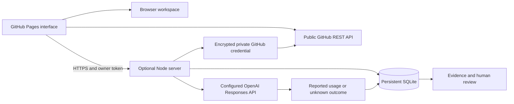

# Worklens architecture

The application reconstructs the original manager workflow: connect a source, identify an account and project, inspect observed usage and work evidence, record a review, and compare a workflow change against accepted work and quality.

## Browser application

The interface is dependency-free ES modules. Hash navigation works under a GitHub Pages repository subpath and survives refresh, Back and Forward. The example workspace uses synthetic records in memory; the visitor's own local workspace uses a separate localStorage key. A backend origin and owner token can be retained in sessionStorage for the current tab.

The browser never takes provider API keys. Public repository metadata can be fetched without credentials. Private repository credentials can only be submitted to a connected backend. DOM output from imported or remote data is escaped before rendering; source links must use HTTPS. CSV exports neutralize formula prefixes.

## Server application

`server/index.mjs` provides a single-owner HTTP API. An operator-supplied bearer token authenticates requests. This is an owner pilot, not multi-user authorization or SSO. Deploy one process against one persistent SQLite volume. Do not share the owner token with employees; add organization authentication and role checks before a company rollout.

Exact-origin CORS protects browser access. Bearer authentication is required for all API operations; requests without an Origin remain possible for authenticated operator tools. Inputs are bounded and validated. Mutations include a workspace revision and fail on stale writes. A single SQLite transaction protects each mutation. Private GitHub tokens are stored as AES-GCM ciphertext with the connection ID as associated data.

## Managed AI lifecycle

1. Validate account, project, work label, prompt and output cap. Require a configured server provider key.
2. Hash the request content for idempotency. An existing request ID with changed content is rejected; an unchanged duplicate never sends another provider request.
3. In a transaction, check account pause and UTC-month company/account allowance, permit only one pending request, and reserve conservative input capacity plus the output cap.
4. Send a text-only Responses API request with provider-side storage disabled. The provider still receives the prompt and processes it under its own terms.
5. Record valid input/output usage and release the reservation. A known client rejection records zero usage; network/server errors or missing counts remain unknown.
6. Requests pending beyond two minutes become unknown. A nonce and pending-status guard stop a late result from overwriting an already recovered or settled request.
7. Reconciliation requires nonnegative verified token counts and a provider-reference note. The app labels these counts owner-entered and releases the reservation.

Prompt and response bodies are not persisted. The answer is returned only to the requesting browser. Request fingerprints persist after event retention so an old request ID cannot be replayed.

## GitHub evidence

Connections support five repositories. Collection reads repository metadata, up to 100 default-branch commits and 100 pull requests sorted by recent update. Full windows with a next page are marked partial. Event identity combines repository, record type and provider SHA/number; reconnecting cannot duplicate the same record. A review note survives upserts. A sync cannot insert events after its connection is removed. Exact GitHub usernames map source authors to owner-assigned accounts.

Project briefs count the retained commits, pull requests and explicitly attributed managed requests. They include source descriptions and contributors. They do not infer blockers, accepted work, full company status, time saved or knowledge gained.

## Differences from the lost hosted implementation

The original used a private Sites/Cloudflare Worker and D1. The new public Pages frontend requires a different hosting split, so this rebuild uses an optional portable Node/SQLite server. The backend is included in full; it is not hosted on Pages. The latest original chat described hourly background collection, but this rebuild deliberately labels collection as page-open only. Adding unattended collection requires a separately hosted scheduler and operator authorization.

The original planning modules are represented by editable, evidence-oriented records, not proprietary Workhelix models, vendor benchmarks or inferred skill scores. The savings worksheet is a new functional implementation of the original PDF's manual comparison.
